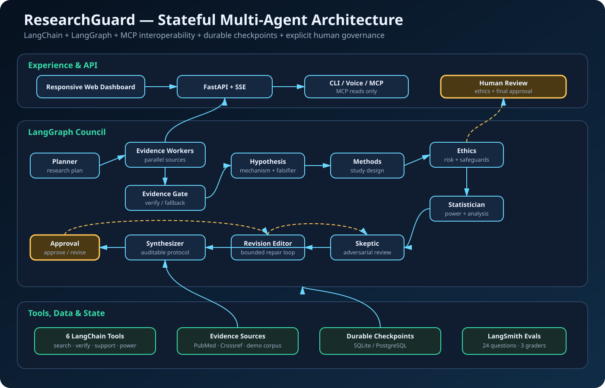

# Executive Summary

ResearchGuard is a stateful multi-agent system that turns a research question into an evidence-grounded, statistically viable, ethics-reviewed experimental protocol. It combines six LangChain tools with a 15-node LangGraph state machine, durable checkpoints, parallel evidence collection, bounded critique-and-revision loops, explicit human approval, LangSmith evaluation, optional ElevenLabs voice services, and a read-only Model Context Protocol (MCP) server.

The primary user is a research student or early-stage research team working in a responsive web dashboard. ResearchGuard replaces hours or days of manual literature searching, citation checking, hypothesis formation, study design, sample-size estimation, ethics review, peer critique, and version tracking with one inspectable workflow. It is designed for local coursework, portfolio review, and controlled demonstrations rather than public multi-tenant deployment.

**Project success target:** at least 90% of users should be able to review, approve, and export a source-traceable protocol in under 10 minutes with no unresolved critical risks.

# Project Overview

## Problem

Designing a defensible research protocol is not a single-answer task. It requires evidence retrieval, claim verification, hypothesis construction, methods design, statistical planning, ethics assessment, adversarial review, revision, and documented human judgment. Today these activities are commonly split across search engines, spreadsheets, documents, calculators, meetings, and manual version comparison.

## Solution

ResearchGuard models that work as a council of specialists. Each agent owns a distinct artifact and quality criterion, while LangGraph makes routing, recovery, memory, loops, and interrupts explicit. The result is not merely generated prose: it is a persisted, inspectable protocol with evidence provenance, uncertainty signals, critique history, revision diffs, ethics safeguards, and a human approval record.

## Primary Workflow

1. Accept the research question and constraints.
2. Create a structured research plan.
3. Dispatch evidence searches in parallel.
4. Verify citations and screen claim support.
5. Recover with a bundled offline corpus if live evidence tools fail.
6. Form a hypothesis with a mechanism and falsifier.
7. Design the study and controls.
8. Assess ethics risk and pause for human safeguards when required.
9. Build the statistical plan and estimate enrollment.
10. Challenge the protocol through skeptical review.
11. Revise high-severity weaknesses through a bounded loop.
12. Synthesize the protocol and pause for final human approval.
13. Persist, compare, inspect, and export the approved result.

# Architecture

{width=100%}

## Architectural Layers

| Layer | Main components | Responsibility |
|---|---|---|
| Experience | Responsive HTML/CSS/JavaScript dashboard, CLI, browser speech, optional ElevenLabs voice | Question entry, live progress, evidence inspection, review, approval, comparison, and export |
| API | FastAPI, Server-Sent Events, WebSocket voice adapter | Run lifecycle, streaming state, ownership checks, reports, recovery, and voice endpoints |
| Orchestration | LangGraph `StateGraph` with 15 nodes | Parallel dispatch, conditional routing, revision loops, interrupts, completion, and timing |
| Intelligence | LangChain structured agents plus deterministic CI agents | Planning, evidence analysis, hypothesis, methods, ethics, statistics, skepticism, and revision |
| Tools | Six LangChain tools | Search, verification, claim-support screening, and sample-size calculation |
| State | Typed `ResearchState`, Pydantic artifacts, LangGraph checkpointers | Durable artifacts, events, failures, revisions, approvals, and resumability |
| Persistence | SQLite locally; PostgreSQL optionally | Cross-session checkpoints, thread metadata, ownership, archive, and history |
| Evaluation | LangSmith dataset/evaluators plus Pytest and Playwright/Axe | Grounding, design safety, collaboration value, behavior, accessibility, and regressions |
| Interoperability | Official Python MCP SDK v2 over local stdio | Six read-only tools, protocol/about resources, and a governed study-design prompt without bypassing human approval |

## Agent Responsibilities

| Agent/node | Artifact or decision owned |
|---|---|
| Research planner | Research plan, task ownership, and evidence-source strategy |
| Evidence workers | Source-specific evidence records collected in parallel |
| Evidence gate | Verification outcome, partial-outage warning, or fallback routing |
| Hypothesis scientist | Testable statement, mechanism, and falsifier |
| Methods designer | Population, intervention, comparator, outcome, duration, and controls |
| Ethics reviewer | Risk level, findings, required safeguards, and human-review requirement |
| Ethics revision editor | Integration of human-mandated safeguards |
| Statistician | Primary metric, analysis, assumptions, and target sample size |
| Skeptical reviewer | Severity-ranked design and evidence critiques |
| Revision editor | Bounded repair of high-severity weaknesses |
| Protocol synthesizer | Final auditable protocol object |
| Human approval | Consequential approve-or-revise decision |

## State and Memory

The core workflow state includes the question, constraints, plan, evidence, failures, warnings, hypothesis, study design, ethics assessment, statistical plan, critiques, revision history, approval decisions, events, and status. LangGraph checkpoints this state under a stable thread ID in SQLite for the local project or PostgreSQL when configured, so runs survive refreshes and process restarts.

Browser local storage is intentionally separate from scientific state. It stores interface preferences, bookmarks, saved filters, review comments, inbox activity, timing observations, and usability feedback; these can be exported or cleared from the privacy center.

## Human-in-the-Loop Boundaries

ResearchGuard autonomously performs reads, calculations, drafting, and internal critique. It pauses when consequential ethics safeguards require review and again before the protocol is finalized; a human can approve, request exact changes, edit protocol fields, or stop the run, and those interventions enter the audit and revision history.

# Tools and Actions

ResearchGuard exposes six LangChain tools:

1. **PubMed search (read):** retrieves traceable article metadata and abstracts through NCBI APIs.
2. **Crossref search (read):** retrieves DOI-backed scholarly metadata.
3. **Demonstration-corpus search (read):** provides deterministic offline evidence and recovery.
4. **Citation verification (read/validation):** checks stable PMID, DOI, or approved demo identifiers.
5. **Claim-support screening (read/analysis):** extracts the closest supporting passage and a lexical entailment score.
6. **Two-arm sample-size estimation (calculation):** computes transparent approximate enrollment.

The system creates and revises internal protocol drafts, but it does not publish research, recruit participants, spend money, execute a study, or approve its own final protocol.

The MCP interface exposes the same governed read and calculation capabilities to compatible hosts. Write actions—approval, protocol editing, archive, and deletion—are deliberately excluded from MCP and remain in the human-controlled application workflow.

# Datasets and Evidence Sources

## Bundled Demonstration Corpus

The repository contains three synthetic, auditable evidence records used for deterministic demonstrations and offline recovery:

| Topic | Purpose | Important limitation |
|---|---|---|
| Sleep and memory consolidation | Exercises observational-confounding and learning questions | Synthetic demonstration evidence, not a real citation |
| Exercise and mental wellbeing | Exercises adherence and expectancy threats | Synthetic demonstration evidence, not a real citation |
| Adaptive AI tutoring | Exercises algebra performance and far-transfer design | Synthetic demonstration evidence, not a real citation |

The UI labels these records prominently as synthetic. They support repeatable workflow demonstrations, not scientific conclusions.

## Dynamic External Evidence

PubMed and Crossref are live retrieval sources, not packaged training datasets. PubMed supplies article identifiers, metadata, and available abstracts; Crossref supplies DOI-backed metadata and available abstracts. ResearchGuard does not bypass paywalls or claim access to full text.

## LangSmith Evaluation Dataset

`researchguard-local-protocol-quality-v2` contains 24 generated research questions spanning education, health behavior, workplace studies, technology, and learning. Each example expects evidence grounding and attrition modeling; three code-based graders measure evidence grounding and design safety for both systems, while collaboration value applies only to the multi-agent council.

## Training Disclosure

No model fine-tuning or private training dataset is used. The project evaluates orchestration and workflow quality using deterministic fixtures and hosted LangSmith examples.

# Prompts Used During Vibe Coding

The project was developed through iterative natural-language requests paired with code inspection, implementation, and automated verification. The following are representative user prompts from the build workflow; they document product direction and are not hidden model reasoning.

| Stage | Representative prompt | Resulting decision |
|---|---|---|
| Concept selection | “Let’s build ResearchGuard.” | Chose an evidence-grounded research protocol council as the multi-agent use case |
| Framework compliance | “Are all these requirements met: code-heavy with LangChain + LangGraph…?” | Added explicit agents/tools, graph state, checkpoints, interrupts, LangSmith evaluation, and voice adapters |
| Scope completion | “Let’s add them all.” | Implemented the missing production-shaped building blocks rather than a thin prototype |
| Repository organization | “Move the contents under Week 3 AI Agent.” | Consolidated the application into the requested project folder |
| Presentation language | “Keep those—just remove any reference to judge demo.” | Preserved deterministic showcase behavior while removing judge-specific copy |
| UX expansion | “Any UX/UI enhancements needed or recommended?” followed by “Add all of these.” | Added live graph inspection, evidence provenance, revisions, uncertainty, comparison, recovery, themes, accessibility, and responsive design |
| Advanced UX | “Let’s do all 15.” | Added recent runs, history, editing, notifications, onboarding, internationalization readiness, Playwright, and Axe |
| Trust and collaboration | “Go for it.” | Added presentation mode, scorecards, disagreement views, traceability, before/after comparison, command palette, and visual regression |
| Review workflow | “Do it.” | Added simple/expert modes, roles, comments, bookmarks, approval readiness, activity inbox, design tokens, and usability capture |
| Privacy and security | “Any security enhancements needed or recommended?” | Added local-project security headers, upload limits, safe links, privacy controls, tests, and security documentation |
| Release safety | “Let’s do that.” | Added the packaged `researchguard-security-check` command with secret, dependency, test, binding, and artifact checks |
| MCP interoperability | “Can we add MCP now?” | Added an official SDK v2 stdio server with six read-only tools, two resources, and one governed prompt |
| Evaluation correction | “How to fix this single-agent collaboration value: 0/24?” | Separated task completion from collaboration, gave both systems equivalent evidence, and marked collaboration not applicable for a true single-agent baseline |
| Demonstration data | “Set up the page to demo unique inputs.” | Replaced repeated workspace questions with varied, generic research scenarios while retaining deterministic behavior |
| Local voice and HTTPS | “How to make HTTPS localhost?” and “Microphone does not work.” | Added validated local certificate settings and documented browser permission and secure-context requirements |
| Safe sharing | “How to safely push this code to GitHub repo?” | Expanded ignore rules for environment files, certificates, database sidecars, build output, and generated artifacts; strengthened pre-share scanning |

# Iterations Tried

## Iteration 1 — Deterministic Multi-Agent Core

The first usable version focused on a deterministic LangGraph council with specialist artifacts, a local evidence corpus, a skeptical reviewer, a bounded revision loop, and final human approval. This established reliable control flow before adding external services.

## Iteration 2 — Live Tools, Persistence, and Evaluation

PubMed, Crossref, citation verification, abstract support screening, sample-size estimation, SQLite/PostgreSQL checkpoints, background execution, LangSmith tracing, and a 24-question evaluation suite were added. A one-pass baseline made the value of multi-agent review measurable rather than assumed.

## Iteration 3 — Recovery and Governance

Tool retries, partial-evidence continuation, explicit fallback routing, ethics interrupts, cancellation, and human feedback-driven revisions were introduced. The workflow moved from “happy-path generation” to a stateful system that could explain and recover from failure.

## Iteration 4 — Inspectable Web Experience

The inline interface was separated into maintainable frontend assets. Live SSE updates, graph visualization, evidence cards, source labels, score explanations, audit timing, field-level diffs, and accessible decision dialogs made internal state legible.

## Iteration 5 — Workspace and Trust Features

Recent runs, archive/delete/undo, comparison, revision history, graph-node inspection, evidence provenance, uncertainty, protocol editing, presentation mode, disagreement resolution, claim traceability, and draft-to-final comparison were layered onto the core workflow.

## Iteration 6 — Accessibility, Collaboration, and Release Quality

Simple/expert modes, role emphasis, mobile workflow inspection, bookmarks, saved filters, threaded comments, approval readiness, an activity inbox, privacy controls, design tokens, onboarding, notifications, keyboard navigation, high contrast, reduced motion, Playwright/Axe checks, and visual snapshots completed the experience.

## Iteration 7 — Local Security Freeze

The final iteration clarified that the system is a local project rather than a production identity platform. It added CSP and security headers, safe evidence links, bounded voice uploads, constant-time key checks, sensitive-artifact exclusions, dependency auditing, and a consolidated security command, then froze feature development.

## Iteration 8 — MCP and Fair Baseline Evaluation

An official Python MCP SDK v2 server was added as a read-only integration boundary, preserving the LangGraph approval gates for consequential changes. The evaluation design was corrected so the one-pass baseline received equivalent topic-specific evidence: both systems completed 24/24 deterministic drafting tasks, while collaboration value remained a council-only measure rather than an automatic baseline failure.

## Iteration 9 — Demonstration Reliability and Safe Handoff

Recent-workspace questions were diversified, local HTTPS certificate configuration was added for browser microphone access, port-conflict troubleshooting was documented, and GitHub exclusions were strengthened. These changes improved recording reliability and made project sharing safer without turning a local educational application into an overclaimed production deployment.

# Learnings and Observations

## 1. Multi-agent value must be visible

Multiple agent names are not sufficient. The strongest evidence of collaboration came from separate artifacts, parallel evidence work, explicit disagreement, a revision diff, and comparison with a one-pass baseline.

## 2. Control flow is the product

Conditional edges, bounded loops, retries, fallback routes, and interrupts mattered more than a single sophisticated prompt. LangGraph made these decisions testable and inspectable.

## 3. Persistent state changes the demonstration

Checkpointing converted the system from a transient chatbot into a resumable workflow. Thread history, approvals, failures, and revisions could be recovered after refresh or restart rather than reconstructed from conversation text.

## 4. Evidence verification requires more than an identifier

A valid DOI or PMID only proves traceability. Claim-level support required an abstract, a supporting passage, a screening score, and clear language that the result still needs human review.

## 5. Failure paths are persuasive

The deterministic showcase intentionally exercises an evidence outage. Showing retry, partial continuation, and offline recovery made the system more credible than hiding errors behind generic loading states.

## 6. Human approval should guard consequential decisions

Autonomous reading and drafting improved speed, but ethics safeguards and final protocol acceptance remained human responsibilities. Interrupts were more defensible than post-hoc disclaimer text alone.

## 7. UX complexity needs progressive disclosure

Graph internals, provenance, scores, timings, and revisions help experts but can overwhelm first-time users. Simple/expert modes and role emphasis preserved inspectability without forcing every detail into the primary path.

## 8. Determinism accelerates iteration

An offline mode made tests, demos, screenshots, and accessibility checks repeatable. Live integrations remained optional enhancements instead of dependencies for basic correctness.

## 9. Evaluation should measure workflow completion

The meaningful outcome is an approved, exportable, traceable protocol with no unresolved critical risks—not whether one model response sounds convincing. Code-based graders and end-to-end browser tests reflect that distinction.

## 10. Feature freeze is an engineering decision

Repeated enhancement cycles eventually produced diminishing returns. The final improvement was to stop adding components, formalize usability and release checklists, and automate regression and security checks.

## 11. Baselines must be credible and metrics must fit the system

An early baseline score was misleading because evidence coverage and collaboration were conflated with task completion. Giving both systems equivalent inputs and reporting collaboration as not applicable for a single agent produced a fairer result: parity on safe completion, with the council's extra value visible in critique, revision, provenance, recovery, and approval history.

## 12. Integration boundaries should preserve governance

MCP improved reuse, but exposing approval or destructive operations as tools would have weakened the project's human-in-the-loop claim. Restricting MCP to reads and calculations kept interoperability useful while ensuring consequential writes stayed behind explicit review.

## 13. Local demonstration engineering still needs operational discipline

Microphone permissions, secure browser contexts, occupied ports, synthetic-data labeling, and ignored private keys can determine whether a recording succeeds. A portfolio project benefits from repeatable startup, deterministic inputs, pre-share checks, and honest scope statements even when it is not deployed publicly.

# Validation and Quality Evidence

At the time of this report, the project validation baseline is:

- **54 Python tests** covering graph behavior, LangChain tools, LangGraph interrupts and recovery, MCP capabilities, adversarial quality checks, persistence, API integration, ownership, security controls, and the security checker.
- **18 Playwright tests** across desktop and mobile Chromium.
- **Axe accessibility checks** with no serious or critical violations in the tested interface.
- **Visual regression snapshots** for desktop/mobile workspace and command-palette states.
- **Ruff formatting and lint checks** passing.
- **Python and npm dependency audits** reporting no known high/critical findings during the final security check.
- **Wheel and source distribution builds** verified to include frontend assets and exclude `.env` or database files.
- **24-question deterministic benchmark:** task completion, evidence grounding, and design safety are 24/24 for both the council and credible one-pass baseline; collaboration value is 24/24 for the council and not applicable to the baseline.

# Limitations and Responsible Use

- The bundled evidence corpus is synthetic and exists only for deterministic demonstrations.
- Live PubMed/Crossref results are metadata/abstract based and may be incomplete.
- Lexical entailment is a screening aid, not expert scientific validation.
- Sample-size estimation is a transparent approximation, not a substitute for a statistician.
- ResearchGuard must not receive protected health information or identifiable participant records.
- The shared demo key and user ID are not production authentication.
- The system does not publish, recruit, spend, or execute a study.
- Consequential protocols require domain-expert, statistical, and ethics review.

# Conclusion

ResearchGuard demonstrates that a multi-agent system can make complex research planning more structured, inspectable, and governable. The portfolio value lies not only in model output, but in explicit orchestration, durable state, evidence provenance, recovery, human interrupts, evaluation, and a tested user experience.

ResearchGuard also exposes a read-only Model Context Protocol server using the official Python MCP SDK v2. MCP-compatible hosts can discover six research tools, inspect saved protocols through resources, and invoke a governed study-design prompt. Consequential writes are intentionally excluded so MCP access cannot bypass LangGraph's ethics and final-approval interrupts.

The corrected 24-question deterministic benchmark gives both the multi-agent council and the credible one-pass baseline equivalent topic-specific evidence. Both complete 24/24 safe drafting tasks, preventing corpus coverage from biasing the comparison. ResearchGuard achieves collaboration value on 24/24; that metric is marked not applicable for the single-agent baseline because it has no specialist collaboration to evaluate. These numbers validate offline orchestration and governance behavior; live-model and external-source quality remain separate evaluations requiring provider credentials.

The completed project is intentionally optimized for a reliable local demonstration. Future work should prioritize real usability sessions and domain-expert evaluation rather than additional feature expansion.
